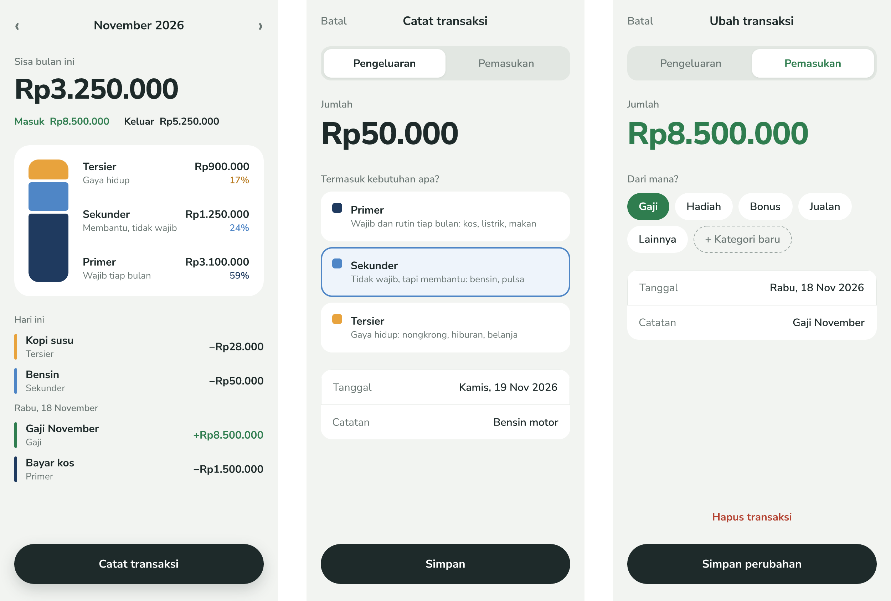

# Catatan Uang

Aplikasi sederhana untuk mencatat pemasukan dan pengeluaran bulanan. Ringan, tanpa login, dan tetap bisa dipakai tanpa internet.

**Buka aplikasi:** https://fyynz71.github.io/money-record/



## Fitur

- **Pemasukan per kategori**: Gaji, Hadiah, Bonus, Jualan, Lainnya, dan kategori buatan sendiri.
- **Pengeluaran bisa diberi tingkat kebutuhan (opsional):**
  - **Primer**: wajib dan rutin tiap bulan (kos, listrik, makan)
  - **Sekunder**: tidak wajib, tapi membantu (bensin, pulsa)
  - **Tersier**: gaya hidup (nongkrong, hiburan, belanja)
- Ringkasan per bulan: sisa uang, total masuk dan keluar, serta porsi tiap tingkat pengeluaran.
- Tambah, ubah, dan hapus transaksi.
- **Catat dengan suara** (eksperimen): ketuk tombol mikrofon, ucapkan transaksinya, lalu cek dan simpan.
- Pindah bulan dari bagian bawah layar: tombol ‹ ›, ketuk nama bulan untuk memilih bulan/tahun, atau geser layar.
- Bisa dipasang ke layar utama HP dan dibuka tanpa internet.

## Catat dengan suara

Contoh kalimat:

- "pengeluaran 50 ribu, hari ini, beli galon"
- "pemasukan 1 juta, kemarin, gaji"
- "pengeluaran 100 ribu, tersier, hari ini jajan"

Yang dikenali:

| Bagian | Contoh |
| --- | --- |
| Jenis | pemasukan, pengeluaran (tanpa kata ini dianggap pengeluaran) |
| Jumlah | 50 ribu, 25rb, 1,5 juta, Rp50.000, lima puluh ribu |
| Tingkat | primer, sekunder, tersier (opsional) |
| Kategori pemasukan | nama kategori, mis. gaji, hadiah (tidak disebut → Lainnya) |
| Tanggal | hari ini, kemarin, kemarin lusa, tanggal 18, 18 november |
| Catatan | sisa kata yang tidak termasuk di atas |

Hasilnya hanya mengisi formulir; transaksi baru tersimpan setelah tombol Simpan ditekan.

Batasan:

- Butuh internet dan izin mikrofon. Suara diproses oleh layanan pengenal suara bawaan browser (Google di Chrome, Apple di Safari).
- Didukung Chrome Android. Safari iPhone mungkin tidak jalan saat dibuka dari layar utama. Firefox tidak didukung (tombol mikrofon tidak muncul).
- Pembacaan berbasis aturan, jadi kalimat yang terlalu bebas bisa salah terbaca.

## Cara pasang di HP

1. Buka alamat aplikasi di Chrome (Android) atau Safari (iPhone).
2. Pilih **Add to Home Screen** atau **Tambahkan ke layar utama**.

## Penyimpanan data

Data hanya tersimpan di browser HP yang dipakai (`localStorage`), tidak dikirim ke server mana pun. Artinya:

- Data tidak pindah otomatis antar HP atau browser.
- Data **hilang** kalau data situs atau cache browser dihapus.

## Menjalankan di komputer

Tidak perlu install atau build. Jalankan server statis apa saja dari folder proyek, misalnya:

```bash
python -m http.server 5173
```

Lalu buka http://localhost:5173.

## Struktur file

| File | Isi |
| --- | --- |
| `index.html` | Tampilan Beranda dan formulir transaksi |
| `style.css` | Gaya tampilan |
| `app.js` | Logika pencatatan dan ringkasan |
| `voice.js` | Pembaca kalimat suara menjadi isian transaksi |
| `sw.js` | Service worker agar bisa dipakai tanpa internet |
| `manifest.json`, `icon.svg` | Pengaturan agar bisa dipasang di HP |
| `money-record.figcraft`, `preview.png` | File desain dan pratinjau tampilan |

## Memperbarui aplikasi

1. Ubah kodenya.
2. Naikkan versi cache di `sw.js` (misalnya `money-record-v1` menjadi `money-record-v2`) agar HP mengambil versi terbaru.
3. Commit dan push ke branch `main`. GitHub Pages akan memperbarui situs dalam sekitar satu menit.
